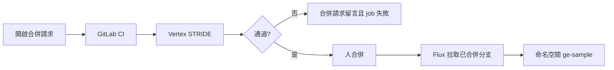
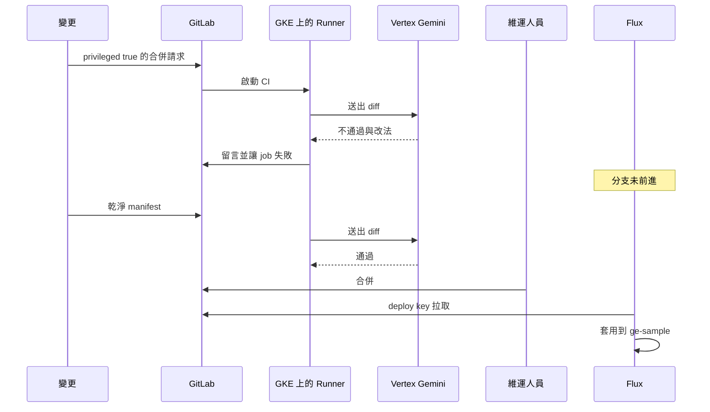

# AI SDLC 與 AI DevSecOps

四段說明的可翻頁版本： [ge-devsecops-briefing.html](ge-devsecops-briefing.html)。總覽見 [GE 實施計畫](2026-10-30-ge-implementation-plan.md)。門禁決策見 [ADR-0037](../adr/0037-ge-demo-gitlab-flux-gate.md)。Mitre 演示的邊界見 [ADR-0038](../adr/0038-ge-demo-mitre-label.md)。

## 四段

1. **觀念。** 以 NextOps 當例子。AI SDLC 是 Gemini 在合併請求上審查變更。AI DevSecOps 是同一條 GitLab CI 讓失敗的修訂到不了叢集。請求裡的「AI DLC」指這條交付迴圈，不是另一個產品。
2. **日常點檢。** 展示 NextOps 畫出的六欄報告、Vertex 寫的 Warning 備註，以及 Google Chat 與 Gmail。廠區欄是報告上的名字。SaaS 用可重現假資料。CaaS 讀這座 GKE 的 Cloud Monitoring。
3. **NextOps 自己的迭代。** 合併請求開在 NextOps 的示範路徑，不是把正在簡報的那個 Helm release 換掉。違規的 manifest 停在 GitLab。通過且經人合併之後，Flux 只把 `deploy/ge-sample` 套用到命名空間 `ge-sample`。
4. **資安監控。** 威脅建模是這次 CI 的 STRIDE，標出 privileged、缺少 limits、明文密鑰。Mitre ATT&CK 是一筆事先放在 `ge-sample` 的事件，畫面上標 T1609（容器內管理指令）。不對叢集發動攻擊，不做橫向移動。應用上線仍是 Spec、中央 Git 合併請求、Dev 驗證與晉升；它不是這次的攻擊模擬器。監控畫面用 NextOps 既有的告警與 Robusta 事件，加上這兩個標籤。

請求裡的「AI DLC」在這份計畫裡叫 **AI SDLC**：Gemini 在合併請求上審查變更。**AI DevSecOps** 是同一條管線把審查變成失敗的 job，讓 Flux 部署不到壞的修訂。兩者不是兩套產品，也不是新的 Operator Role。

## 邊界

示範對象是一個獨立的 GitLab 專案，裡面只有一份 Deployment manifest。它對應 NextOps 應用目錄裡的一個 Application，一對一。NextOps 不變成 GitLab 介面，不代為合併，也不把 GitLab Access 或 GitLab Read Access 交給 Flux。

Flux 使用第三把憑證：該專案的唯讀 deploy key，放在 `flux-system`。GKE 必須打得到公司 GitLab。打不到就不能錄這一段。

## 流程

失敗條件就三條，足以拍片：

1. `securityContext.privileged` 為 true。
2. 容器沒有 `resources.limits`。
3. 環境變數的值像明文密鑰。

Vertex 的留言寫在合併請求上，內容是這三條裡命中的項目與改法。job 失敗。沒有人按合併，Flux 的分支頭不變。

通過的那次仍等人合併。CI 機器人不能合併。合併之後 Flux 以一分鐘間隔把 manifest 同步到 `ge-sample`。

## 互動

Runner 跑在同一座 GKE，用 Workload Identity 呼叫 Vertex，不把 API key 放進 GitLab 變數。

## 與點檢的關係

點檢、Chat、Gmail、Robusta、Crane 維持原計畫。這一段只多兩個鏡頭：一張失敗的合併請求，以及合併後 `ge-sample` 裡的 Pod 出現。NextOps 自身的 Helm release 不在這條 Flux 路徑上。
