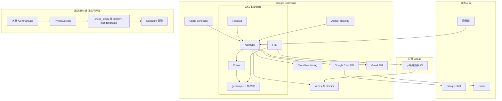
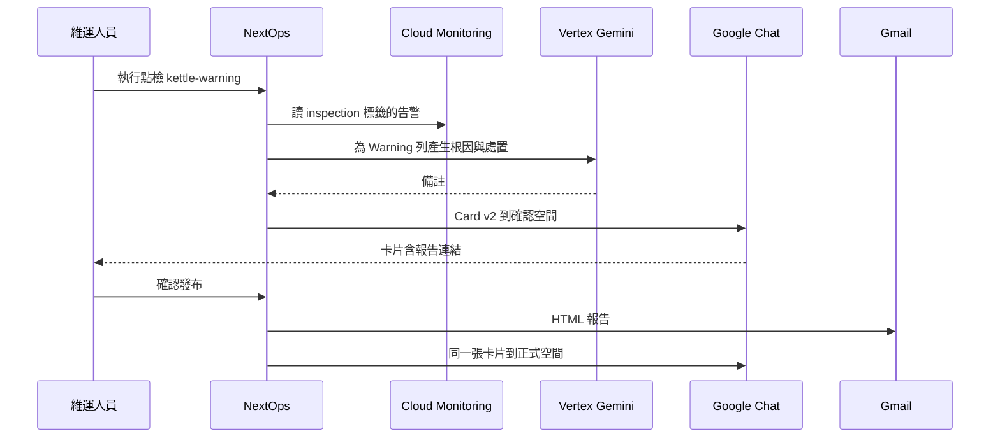
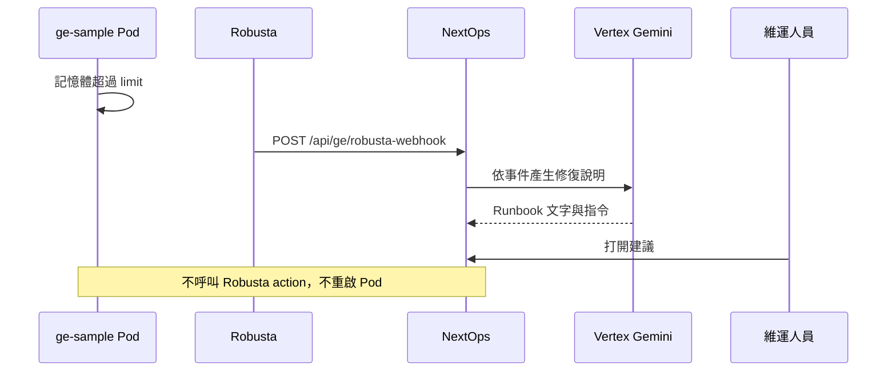
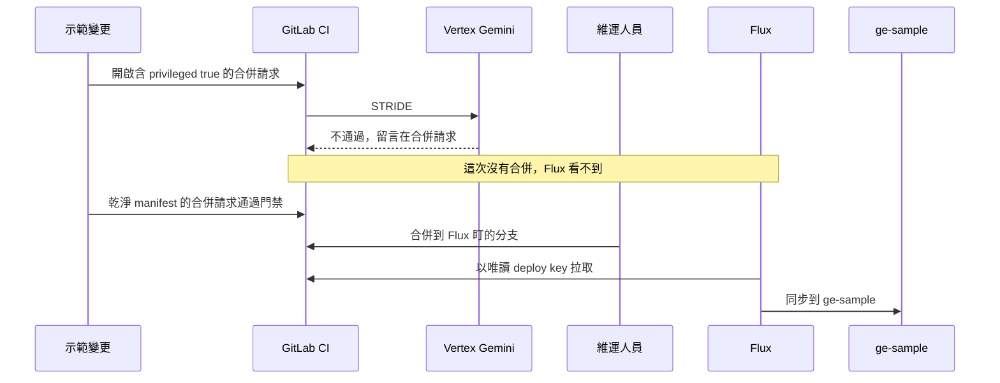

# NextOps GE 實施計畫

2026-10-30 前要交出可演示的系統與影片。決策記錄見 [2026-10-30-ge-hackathon.md](2026-10-30-ge-hackathon.md)。模型呼叫見 [ADR-0036](../adr/0036-ge-hackathon-vertex-transport.md)。

用語用「點檢」。口語裡的「檢點」指同一件事。

## 1. 部署角色

全部落在同一個 GE 專案、同一座 GKE Standard。點檢不另開 Python 服務。

| 角色 | 跑在哪 | 10/30 做什麼 |
| --- | --- | --- |
| NextOps | GKE，Helm，映像在 Artifact Registry | 畫六欄點檢報告、收 Chat 確認、寄 Gmail、顯示 Robusta 建議與 Crane 建議。模型走 Vertex |
| Robusta | GKE，Helm，命名空間 `robusta` | 只看這座叢集。OOM 事件 webhook 到 NextOps。影片裡不重啟 Pod |
| Crane | GKE，Helm，命名空間 `crane-system` | 安裝真的 Crane。另外預寫一筆 Recommendation，讓影片一定看得到 requests／limits |
| Flux | GKE，`flux-system` | 只同步已合併的 GitLab 示範專案到 `ge-sample`。不部署 NextOps 自己 |
| GitLab CI | 公司 GitLab，Runner 在這座 GKE | STRIDE 門禁。`privileged: true` 的合併請求失敗。人不合併，Flux 就看不到 |
| 點檢 | NextOps 行程內 | `POST /api/inspection/run`。沒有獨立的 Inspection Engine |

既有廠區介面留在邊界外，這次演示不呼叫：

| 介面 | 現況角色 |
| --- | --- |
| `https://unified-xops.corp.example.com/inspection/check_alerts` | 各廠告警與登入探針彙整 |
| `https://unified-xops.corp.example.com/platform-monitor/create` | 產出點檢 HTML。Selenium 截的就是這一頁 |

報告頁留接縫，之後才能改嵌 Report API 的 HTML。

## 2. 架構



瀏覽器只打 NextOps。Vertex 用 Workload Identity，不用 API key，也不走 `aiot.corp.example.com` 的 AiBridge。

## 3. GE 上引入的元件

| GE 產品 | 取代什麼 | 在演示裡的用法 |
| --- | --- | --- |
| GKE Standard | 自建或廠區叢集上的示範環境 | NextOps、Robusta、Crane、Flux、示範工作負載 |
| Artifact Registry | 外部映像倉庫 | 存放 NextOps 映像 |
| Workload Identity | 服務帳戶金鑰 | NextOps Pod 呼叫 Vertex、Cloud Monitoring、Gmail |
| Vertex AI Gemini | AiBridge、Excel 手寫備註、人工 RCA | `generateContent`。診斷、點檢備註、Robusta Runbook、STRIDE 同一條 |
| Cloud Monitoring | 演示用的 CaaS 即時狀態 | 三筆政策，`userLabels.inspection` 為 `storage`、`middleware`、`k8s` |
| Google Chat Card v2 | Teams 頻道、Power Automate 轉圖 | 確認空間與正式空間。卡片含回到報告的連結 |
| Gmail | Outlook、Base64 截圖信 | 同一份報告的 HTML |
| Cloud Scheduler | 每天 08:10 與 20:10 的 cron | 呼叫同一個 `POST /api/inspection/run`。影片改按畫面上的按鈕 |
| GitLab CI | 人工看 manifest、Cloud Build 當門禁 | 合併請求上的 STRIDE。失敗的修訂停在 GitLab，Flux 只拉已合併的分支 |
| GitLab 示範專案 | Cloud Source Repositories | 乾淨 manifest 與 `privileged: true` 那份。應用目錄仍是 NextOps 的目錄，不是 GitLab 介面 |
| IAM | 長效金鑰 | runtime 服務帳戶：`roles/aiplatform.user`、`roles/monitoring.viewer` |

Chat 應用程式安裝與 Gmail domain-wide delegation 仍要 Workspace 管理員做。`scripts/ge/bootstrap.sh` 結尾會印出這兩步。

## 4. 被拿掉的腳本與對應方案

| 現況 | 演示裡 |
| --- | --- |
| Python `/create` 呼叫點檢應用 | NextOps `POST /api/inspection/run` |
| Selenium 把 HTML 拍成圖 | 不拍。NextOps 直接畫六欄表 |
| Base64 圖嵌進郵件 | Gmail 寄 HTML |
| Power Automate 把圖轉進 Teams | Google Chat Card v2 |
| Teams | Google Chat。沒有 Meet |
| Outlook | Gmail |
| Excel 寫 Warning 備註 | Vertex 寫根因與處置，填進備註欄 |
| 各廠 Alertmanager 直連進報告 | 上半部 SaaS 用可重現假資料。下半部 CaaS 讀這座 GKE 的 Cloud Monitoring |

SaaS 兩種呼叫：一輪全 OK；一輪把 Kettle／Spark 調度列做成 Warning（失敗率至少 2%）。其餘百分比與次數每次仍會變。廠區欄仍寫龍華、煙台、重慶、北美。那是報告上的名字，不是對四個廠的即時探針。

## 5. 點檢流程

```mermaid
flowchart TD
  startNode[按鈕或 Cloud Scheduler] --> runApi[POST /api/inspection/run]
  runApi --> saas[SaaS 假資料]
  runApi --> caas[Cloud Monitoring 三列]
  runApi --> craneRow[讀取 seeded Recommendation]
  saas --> judge{有 Warning?}
  caas --> judge
  judge -->|否| both[Chat 正式空間與 Gmail 同時送出]
  judge -->|是| vertex[Vertex 寫該列備註]
  vertex --> confirmSpace[Chat 確認空間 Card v2]
  confirmSpace --> click[人點確認發布]
  click --> confirmApi[POST /api/inspection/confirm]
  confirmApi --> publish[Chat 正式空間]
  confirmApi --> gmailSend[Gmail HTML]
```

報告欄位固定為廠區、層級、點檢項目、點檢人、狀態、備註。CaaS 有觸發中的告警就是 Warning，備註列出告警名稱；沒有就是 OK，並寫目前觸發數為 0。

## 6. 互動

### 6.1 Warning 的確認與送出



全數 OK 時沒有確認空間那一步，Chat 正式空間與 Gmail 一起送出。

### 6.2 Robusta



### 6.3 門禁與 Flux



## 7. 程式要補的行為

環境腳本已經在 `scripts/ge/`。下面這些還沒進行程。

1. `/inspection` 與 `POST /api/inspection/run`。報告來源可替換。這次用行程內來源。
2. `POST /api/inspection/confirm`。Warning 才會走到這一步。
3. AiBridge 呼叫點增加傳輸開關。GE 的 Helm 設 `GEMINI_TRANSPORT=vertex`。
4. `POST /api/ge/robusta-webhook`。
5. 畫面上讀 `ge-sample` 的 Recommendation，並放進點檢卡。
6. GitLab 示範專案裡的乾淨 manifest 與違規 manifest，以及呼叫 Vertex 的 CI job。細節見 [AI SDLC 實施計畫](2026-10-30-ge-devsecops-plan.md)。`scripts/ge/deploy.sh` 仍把 Flux 指到 Cloud Source Repositories，實作這一段時要改掉。

診斷、點檢備註、Robusta Runbook、STRIDE 都走 Vertex。廠區那份 `employee_id` multipart 契約留在非 Vertex 的部署。

## 8. 影片五段

1. 點檢。先全 OK，再 Kettle Warning。CaaS 出現一筆這座叢集的真實告警。Chat 確認後，Gmail 與正式空間都出現。
2. Robusta 的 OOM 建議。不重啟。
3. GitLab 合併請求被 STRIDE 擋下。人沒有合併，Flux 沒有部署那一版。
4. Crane 的那筆 Recommendation。
5. Flux 把通過的 manifest 部署到 `ge-sample`。

## 9. 建置順序

```bash
export PROJECT_ID=your-ge-project
bash scripts/ge/bootstrap.sh
export NEXTOPS_ADMIN_PASS='choose-a-demo-password'
bash scripts/ge/deploy.sh
bash scripts/ge/trigger-oom.sh
```

`bootstrap.sh` 建立 API、GKE Standard、Artifact Registry、Workload Identity、Cloud Source Repository，以及三筆 Cloud Monitoring 政策。`deploy.sh` 推映像並安裝 NextOps、Robusta、Crane、Flux。Robusta 的 webhook 會先打到尚未實作的路徑，程式補上之後才算閉環。各階段在 GKE 與 Cloud Console 的落點見 [ge-deploy-briefing.html](ge-deploy-briefing.html)。

驗證結束後清掉會計費的資源。這不會刪除專案，也不會停用 API。Chat 應用程式與 Gmail 委派沒有叢集那種費用，腳本不動它們。

```bash
export PROJECT_ID=your-ge-project
export CONFIRM=delete
bash scripts/ge/teardown.sh
```
